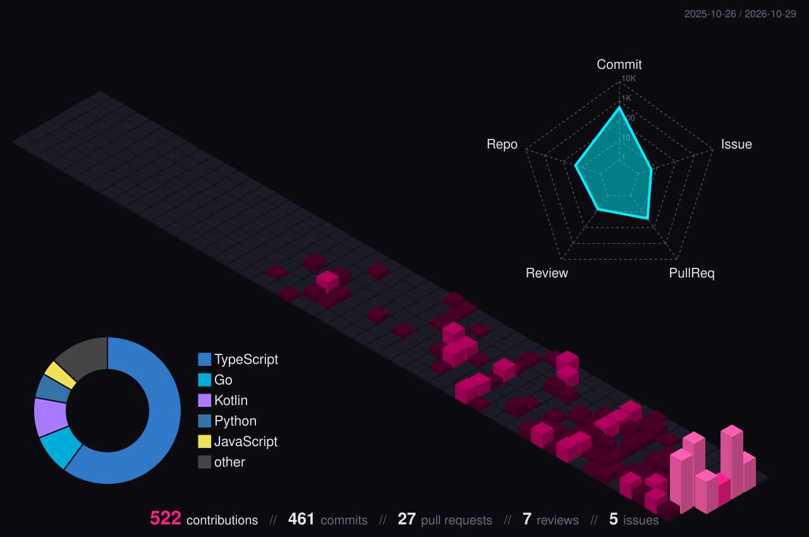

 

 

 

<h3 align="center"><code>paxdot@compass:~$ ls ~/stack</code></h3>

<h3 align="center"><code>paxdot@compass:~$ ./streak --live</code></h3>

  

<h3 align="center"><code>paxdot@compass:~$ exit</code></h3>

